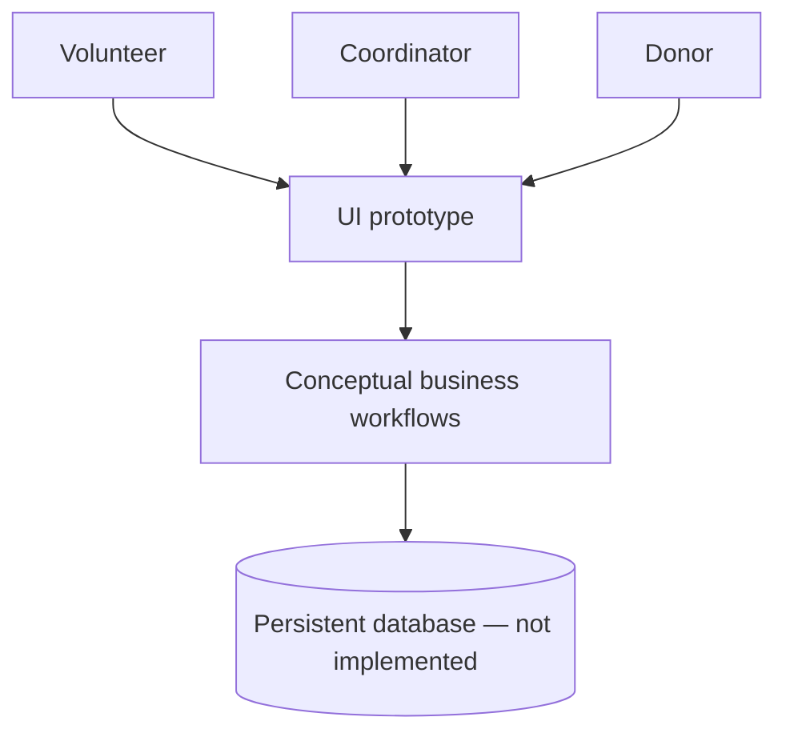

# Volunteer Management System Design

An analysis and interface-prototyping case study for a **fictional nonprofit organization** coordinating volunteers, community projects and donation requests.

## What the design covers

- Stakeholder roles and use cases: donor, volunteer, coordinator and administrator
- Functional and nonfunctional requirements, prioritization and acceptance tests
- Use-case relationships and a basic lifecycle for volunteer matching and donations
- A small **.NET 8 Windows Forms in-memory demo** to illustrate the proposed UI, with no user data or external integrations

## Architecture sketch



## Included

- `docs/requirements.md` — functional and quality requirements
- `docs/use-cases.md` — concise, technology-independent scenarios
- `docs/acceptance-tests.md` — criteria to verify in a future production build
- `prototype/` — minimal Windows-only UI with volunteer and donation entries kept in memory

## Windows UI demo

Requires **Windows** and the **.NET 8 SDK** with Windows desktop support:

```powershell
cd prototype
 dotnet run
```

The demo is intentionally scoped: it has two tabs, validates a few inputs and displays newly added entries for the current session. It does **not** implement authentication, a database, payment processing, organization onboarding, messaging, approvals, auditing or multi-user access. **Do not use it to collect actual donor information.**

## Status

Design case study + minimal educational UI prototype. No claim is made that a production management platform exists. The original collected requirements, meeting recordings and screenshots have been excluded to protect privacy and intellectual property rights. Earlier design work was collaborative; confirm original contribution rights before adding historical artifacts.
